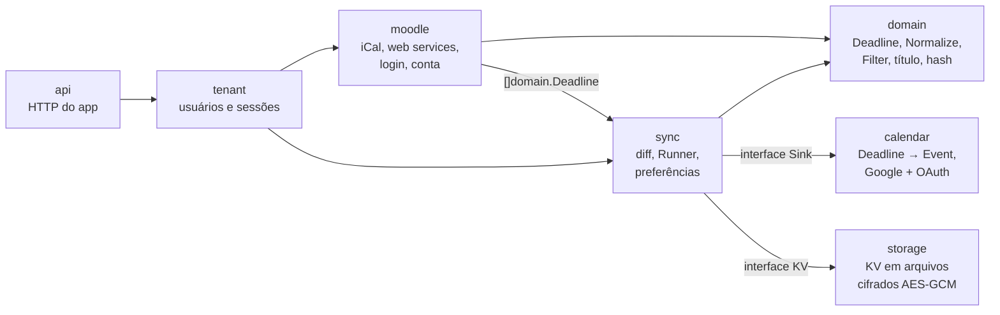

# Arquitetura

## Visão geral

O fluxo de sincronização é `fetch → normalize → diff → apply`. Os pacotes são
organizados **por assunto**, não por camada técnica: tudo o que fala com o
Moodle fica em `moodle`, tudo o que grava no disco em `storage`, e assim por
diante. O domínio não conhece Moodle, Google nem disco.



## Pacotes

```
cmd/prazo/          composição: flags, config, dependências; sem regra de negócio
internal/
├── api/            API HTTP do app: rotas, middleware, DTOs, página de privacidade
├── calendar/       Deadline → Event (id, cor, lembretes) e a interface Sink;
│   │               Google Agenda: GoogleSink, OAuth (terminal e app), revogação
│   └── calendartest/  Sink em memória para testes (como o httptest da stdlib)
├── collections/    Set[T] e Counter[K] genéricos
├── config/         variáveis de ambiente → Config (valida tudo e reporta todos os erros)
├── doctor/         diagnóstico da instância do Moodle (coleta separada da impressão)
├── domain/         entidades e regras puras: Deadline, Normalize, filtros, hash
├── httpx/          cliente HTTP: retry com backoff + jitter, limites, erros sem segredos
├── logging/        slog com redação de segredos
├── moodle/         tudo do Moodle: Source, cliente e parser do iCal, web services,
│                   login (Authenticator), conta conectada, status de entrega,
│                   interpretação de nomes de evento e siglas
├── storage/        interface KV, FileKV (arquivos cifrados, escrita atômica) e AES-256-GCM
├── sync/           caso de uso: Plan, Sync, diff com remoção segura, Runner e preferências
└── tenant/         usuários (um espaço no KV por aluno) e sessões do app
tests/              testes de integração (API inteira via HTTP com Moodle falso)
└── testdata/       fixtures .ics (sintético + real anonimizado do CCT)
docs/               esta documentação
```

### Organização dentro de um pacote

- Um pacote por assunto; os arquivos são nomeados pelo conceito
  (`ical.go`, `ical_parse.go`, `webservice_auth.go`, `google_oauth.go`).
- Tipos e erros ficam no arquivo do conceito a que pertencem, não em
  `types.go`/`errors.go` genéricos.
- `doc.go` traz a descrição do pacote.
- Testes **unitários** ficam ao lado do código (`ical_parse_test.go`), no mesmo
  pacote, para testar também o que não é exportado. Testes de **integração**
  ficam em `tests/` e só usam a API pública dos pacotes.

### Regras de dependência

- `domain` só importa a stdlib e `collections`.
- `moodle` produz `domain.Deadline`; nunca importa `sync`, `calendar` ou `api`.
- `sync` depende das **interfaces** `moodle.Source`, `calendar.Sink` e
  `storage.KV`, nunca das implementações (`ICalSource`, `GoogleSink`, `FileKV`).
- Só `calendar` importa as bibliotecas do Google.
- Só o `cmd/prazo` conhece todas as peças e as conecta.

Interfaces só existem onde há mais de uma implementação real ou um fake de
teste: `moodle.Source` (iCal e o fake do `sync`), `calendar.Sink`
(`GoogleSink` e `calendartest`) e `storage.KV` (`FileKV` e o KV em memória dos
testes).

## Tipos centrais

### `domain.Deadline`

```go
type Deadline struct {
    SourceID    string        // UID do iCal = id do evento no Moodle
    CourseCode  string        // sigla: POO
    CourseName  string        // shortname: 2026/2_CCT_CCI251-03A_POO0002
    Type        DeadlineType  // assign, quiz, forum, exam, course_event, other
    Phase       Phase         // due, open, close, grading, expect, ""
    Title       string        // nome da atividade sem o template do Moodle
    Description string
    URL         string
    StartsAt    time.Time     // sempre UTC
    EndsAt      time.Time     // sempre UTC
    Submitted   bool
    ContentHash string
}
```

O campo `Phase` não estava no desenho original. Entrou porque o Moodle cria
**vários eventos para a mesma atividade** (abertura, fechamento, conclusão
esperada), e o agrupamento precisa saber qual é qual.

Métodos:

- `DisplayTitle()` monta `[SIGLA] Tipo: Título` e adiciona `✅` quando a atividade foi entregue.
- `ComputeHash()` gera um SHA-256 dos campos de conteúdo, usado no diff.

### `domain.Normalize`

Função pura, aplicada nesta ordem:

1. **Agrupa** os eventos de uma mesma atividade. A chave é a disciplina mais o
   título normalizado, com um `map[string]Set[Phase]`.
   - Havendo Término, o Início é descartado (a menos que `IncludeOpenings`).
   - A "conclusão esperada" é descartada quando existe Término ou prazo de entrega.
   - Início e Término a até 12 h um do outro viram **um intervalo** com o
     horário real (ex.: prova online das 19h às 21h).
2. **Descarta** os prazos de correção, que só interessam a professores.
3. **Aplica os filtros** do usuário: disciplina, tipo e regex de título. A busca
   é O(1) com `Set`.
4. **Calcula** o `ContentHash`.
5. **Ordena** por data e `SourceID`, para a saída ser determinística.

### `moodle.Source`

```go
type Source interface {
    Fetch(ctx context.Context) ([]domain.Deadline, error)
}
```

Contrato: **um erro significa que a lista não está completa.** Quem chama nunca
pode apagar eventos com base num fetch que falhou. A Fase 3 implementa essa
proteção no diff.

### `sync.Service` e `sync.Plan`

`Service.Plan(ctx)` busca a fonte e normaliza o resultado, e devolve um `Plan`
com os prazos, a quantidade bruta recebida e o instante do cálculo. O relógio
é injetável (`WithClock`) para os testes.

`Plan.Upcoming(window)` recorta a janela usada na tabela do dry-run.

`Service.Sync(ctx, Target)` calcula o plano e aplica cada prazo no `Sink`:

- garante a agenda dedicada (recria se o usuário apagou) e guarda o id no `KV`;
- faz upsert de cada evento: o id é determinístico, então repetir não duplica;
- uma falha isolada não interrompe os demais; `calendar.ErrAuth`,
  `calendar.ErrCalendarGone` e cancelamento interrompem;
- **não apaga nada** até a Fase 3, que traz o estado necessário para
  distinguir "apagado no Moodle" de "saiu da janela da exportação".

### `calendar.Event`

`calendar.FromDeadline` traduz o prazo para a agenda:

| Aspecto | Regra |
|---|---|
| id | base32hex de `prazo:<SourceID>` (alfabeto `a-v0-9` do Google) |
| janela | intervalo real quando existe; senão 30 min **terminando** no prazo |
| cor | FNV da sigla → `colorId` 1–11, estável entre execuções |
| lembretes | entrega 3d/1d/2h · prova 7d/1d · questionário 1d/2h · demais 1d · nenhum se entregue |
| ocupado | só provas com intervalo real bloqueiam a agenda; prazos ficam "livre" |
| metadados | `extendedProperties.private`: `source_id`, `content_hash` |

## Tratamento de erros

- Os erros sempre carregam contexto: `fmt.Errorf("fetch ical: %w", err)`.
- Condições que o chamador precisa distinguir viram sentinelas, testáveis com
  `errors.Is`. Exemplos: `moodle.ErrNotICalendar`, `moodle.ErrServiceUnavailable`
  e `httpx.ErrBodyTooLarge`.
- Erros que carregam dados são tipos, testáveis com `errors.As`:
  `httpx.StatusError` (código e Retry-After) e `moodle.WebServiceError`
  (função, código e mensagem).
- Não há `panic` fora do `main`.

## Fuso horário

O domínio inteiro trabalha em UTC. A conversão para `America/Sao_Paulo`
(configurável em `PRAZO_TIMEZONE`) acontece só na borda: tabela, mensagens,
o fuso da agenda criada e o `timeZone` de cada evento.

O binário embute o `time/tzdata`, então funciona na imagem distroless.
