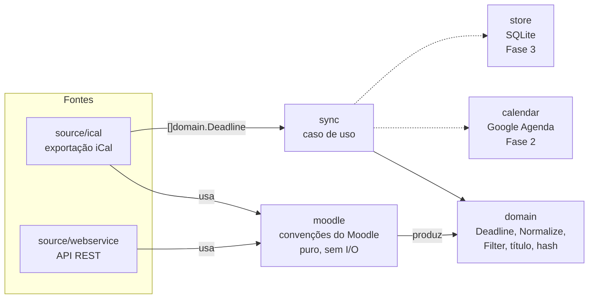

# Arquitetura

## Visão geral

O fluxo de sincronização é `fetch → normalize → diff → apply`. Cada etapa
mora num pacote com uma responsabilidade só. O domínio não conhece Moodle,
Google nem banco.



## Pacotes

```
cmd/prazo/                 composição: flags, config, dependências; sem regra de negócio
internal/
├── collections/           Set[T] e Counter[K] genéricos
├── config/                variáveis de ambiente → Config (valida tudo e reporta todos os erros)
├── domain/                entidades e regras puras
├── moodle/                interpretação de convenções do Moodle (nomes de evento, shortnames)
├── source/                interface Source
│   ├── ical/              cliente e parser da exportação iCal + adaptador para Source
│   └── webservice/        cliente da API REST e dos endpoints públicos do app
├── sync/                  caso de uso: Service.Plan (Fase 1); diff/apply nas Fases 2–3
├── doctor/                diagnóstico da instância (coleta separada da impressão)
├── httpx/                 HTTP com retry, backoff + jitter, limite de concorrência e de corpo
└── logging/               slog com redação de segredos
testdata/                  fixtures .ics (sintético + real anonimizado do CCT)
docs/                      esta documentação
```

### Organização interna de cada pacote

Todos seguem o mesmo padrão:

| Arquivo | Conteúdo |
|---|---|
| `types.go` | tipos exportados do pacote e a doc do pacote |
| `errors.go` | erros sentinela (`ErrX`) e tipos de erro (`*MoodleError`, `*StatusError`) |
| demais `.go` | comportamento, agrupado por assunto (`client.go`, `auth.go`, `api.go`, `parse.go`...) |
| `*_test.go` | testes da própria package (white-box) |

### Regras de dependência

- `domain` só importa a stdlib e `collections`.
- `moodle` importa `domain` (produz `DeadlineType`/`Phase`) e nunca faz I/O.
- `source/*` importam `domain` e `moodle`. Uma fonte nunca importa outra.
- `sync` depende da **interface** `source.Source`, não das implementações.
- Só o `cmd/prazo` conhece todas as peças e as conecta.

Interfaces só existem onde há mais de uma implementação real ou um fake de
teste: `source.Source` (iCal e webservice, e o fake do `sync`) e, na Fase 2,
`calendar.Sink`.

## Tipos centrais

### `domain.Deadline`

```go
type Deadline struct {
    SourceID    string        // UID do iCal = id do evento no Moodle
    CourseCode  string        // sigla: POO
    CourseName  string        // shortname: 2026/2_CCT_CCI251-03A_POO0002
    Type        DeadlineType  // assign, quiz, forum, exam, course_event, other
    Phase       Phase         // due, open, close, grading, expect, ""
    Title       string        // nome da atividade sem o template do Moodle
    Description string
    URL         string
    StartsAt    time.Time     // sempre UTC
    EndsAt      time.Time     // sempre UTC
    Submitted   bool
    ContentHash string
}
```

O campo `Phase` não estava no desenho original. Entrou porque o Moodle cria
**vários eventos para a mesma atividade** (abertura, fechamento, conclusão
esperada), e o agrupamento precisa saber qual é qual.

Métodos:

- `DisplayTitle()` monta `[SIGLA] Tipo: Título` e adiciona `✅` quando a atividade foi entregue.
- `ComputeHash()` gera um SHA-256 dos campos de conteúdo, usado no diff.

### `domain.Normalize`

Função pura, aplicada nesta ordem:

1. **Agrupa** os eventos de uma mesma atividade. A chave é a disciplina mais o
   título normalizado, com um `map[string]Set[Phase]`.
   - Havendo Término, o Início é descartado (a menos que `IncludeOpenings`).
   - A "conclusão esperada" é descartada quando existe Término ou prazo de entrega.
2. **Descarta** os prazos de correção, que só interessam a professores.
3. **Aplica os filtros** do usuário: disciplina, tipo e regex de título. A busca
   é O(1) com `Set`.
4. **Calcula** o `ContentHash`.
5. **Ordena** por data e `SourceID`, para a saída ser determinística.

### `source.Source`

```go
type Source interface {
    Fetch(ctx context.Context) ([]domain.Deadline, error)
}
```

Contrato: **um erro significa que a lista não está completa.** Quem chama nunca
pode apagar eventos com base num fetch que falhou. A Fase 3 implementa essa
proteção no diff.

### `sync.Service` e `sync.Plan`

`Service.Plan(ctx)` busca a fonte e normaliza o resultado, e devolve um `Plan`
com os prazos, a quantidade bruta recebida e o instante do cálculo. O relógio
é injetável (`WithClock`) para os testes.

`Plan.Upcoming(window)` recorta a janela usada na tabela do dry-run.

## Tratamento de erros

- Os erros sempre carregam contexto: `fmt.Errorf("fetch ical: %w", err)`.
- Condições que o chamador precisa distinguir viram sentinelas, testáveis com
  `errors.Is`. Exemplos: `ical.ErrNotICalendar`, `webservice.ErrServiceUnavailable`
  e `httpx.ErrBodyTooLarge`.
- Erros que carregam dados são tipos, testáveis com `errors.As`:
  `httpx.StatusError` (código e Retry-After) e `webservice.MoodleError`
  (função, código e mensagem).
- Não há `panic` fora do `main`.

## Fuso horário

O domínio inteiro trabalha em UTC. A conversão para `America/Sao_Paulo`
(configurável em `PRAZO_TIMEZONE`) acontece só na borda: tabela, mensagens e,
na Fase 2, o evento do Google.

O binário embute o `time/tzdata`, então funciona na imagem distroless.
