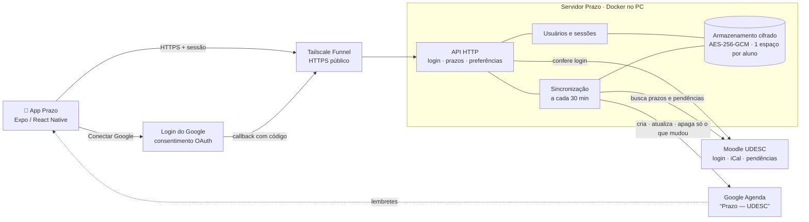
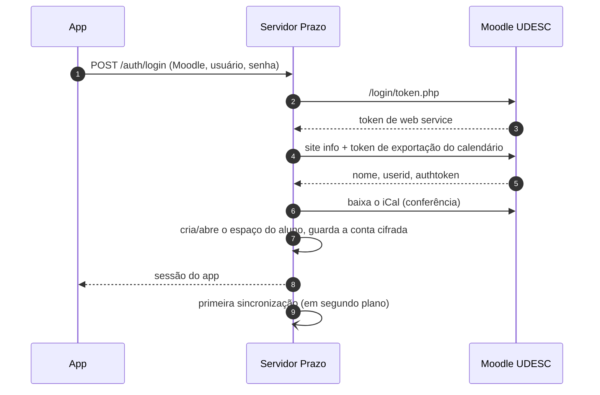
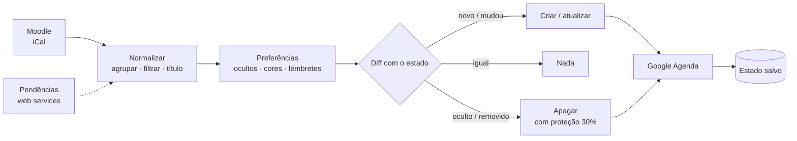

# Fluxo completo do Prazo

## Peças

| Peça | O que é | Onde roda |
|---|---|---|
| **App Prazo** | React Native (Expo): login, prazos, disciplinas, ajustes | celular do aluno |
| **Tailscale Funnel** | endereço HTTPS público fixo (`https://prazo.<tailnet>.ts.net`) que repassa para o servidor | no PC, ao lado do servidor |
| **Servidor Prazo** | Go, `prazo serve` em Docker: API, usuários, sincronização | no PC (liga junto com ele) |
| **Armazenamento** | arquivos cifrados com AES-256-GCM, um espaço por usuário | pasta `data/` no PC |
| **Moodle UDESC** | login, exportação iCal do calendário, web services | servidores da UDESC |
| **Google** | consentimento (OAuth) e a agenda "Prazo — UDESC" | nuvem do Google |

## 1. Entrar no app (login com o Moodle)

1. O aluno abre o app, escolhe o Moodle (CCT Joinville, UDESC geral ou outro)
   e digita usuário e senha.
2. O app envia para `POST /auth/login` no servidor, por HTTPS (Tailscale).
3. O servidor confere se o Moodle está na lista permitida (`PRAZO_MOODLE_HOSTS`)
   e faz login no serviço do app oficial (`/login/token.php`), recebendo um
   token de web service. **A senha é usada só aqui e é descartada.**
4. Com o token, pede ao Moodle os dados do aluno (nome, userid) e o
   **authtoken de exportação do calendário**
   (`core_calendar_get_calendar_export_token`), e monta a URL do iCal.
5. Baixa o calendário para conferir que funciona.
6. Cria (ou reencontra) o **espaço do aluno**, identificado por um hash do
   Moodle + userid, e guarda a conta cifrada.
7. Emite uma **sessão do app** (token aleatório; no disco fica só o hash) e
   já dispara a primeira sincronização.
8. O app guarda a sessão no Keychain/Keystore do celular.

Contas que só entram pelo id.udesc / Office 365 colam a **URL do calendário**
(`POST /auth/ical`); o servidor confere baixando o calendário.

## 2. Conectar o Google Agenda

1. Logo depois do login, o app mostra "Agora o Google Agenda".
2. Ao tocar em **Conectar**, o app pede `POST /api/v1/google/auth`; o servidor
   gera o link de consentimento com `state` de uso único (10 min) e PKCE.
3. O app abre o link numa sessão de autenticação do sistema; o aluno entra no
   Google e autoriza **só** a permissão de agendas criadas pelo Prazo
   (`calendar.app.created`): o Prazo não lê nem mexe no resto da conta.
4. O Google devolve o código para `https://…ts.net/oauth/google/callback`
   (público, protegido pelo `state`).
5. O servidor troca o código por um refresh token, guarda cifrado no espaço do
   aluno e sincroniza na hora. O navegador volta sozinho para o app.

## 3. Sincronização (a cada 30 minutos, para todos)

Um aluno de cada vez, para não sobrecarregar o Moodle nem o Google:

1. **Buscar:** baixa o iCal do aluno no Moodle. Se a busca falhar, para aqui e
   **nada é apagado**.
2. **Status de entrega:** para quem entrou com usuário e senha, consulta as
   pendências; o que estava pendente e saiu da lista antes do prazo vira ✅.
3. **Normalizar:** junta Início/Término/conclusão da mesma atividade, descarta
   prazos de correção, aplica filtros e padroniza o título
   (`[POO] Entrega: Aula Prática 9`).
4. **Preferências do aluno:** disciplinas e tipos ocultos, cor de cada
   disciplina, lembretes por tipo.
5. **Diff com o que já está na agenda** (estado guardado):
   - novo → cria; mudou → atualiza; igual → não faz nada;
   - oculto → apaga;
   - sumiu do Moodle e ainda não passou → apaga;
   - sumiu porque já passou → só esquece (o evento fica na agenda);
   - **proteção:** se mais de 30% sumir de uma vez, não apaga nada.
6. **Aplicar** no Google: id de evento fixo por prazo (nunca duplica), cor da
   disciplina, lembretes, horário real ou 30 min terminando no prazo.
7. **Guardar o estado** do que ficou na agenda.

## 4. Personalizar no app

- **Disciplinas:** trocar a cor (as 11 do Google) ou ocultar.
- **Ajustes:** lembretes por tipo (até 5), tipos visíveis, sincronizar agora.
- Tudo vai para `PUT /api/v1/preferences`, fica no espaço do aluno e vale na
  próxima sincronização (ou na hora, com "Sincronizar agora").

## 5. Senha do Moodle trocada

O authtoken do calendário depende da senha. Quando ela muda, o Moodle
responde exatamente "Invalid authentication":

1. O servidor marca a conta como "precisa entrar de novo" e para de chamar o
   Moodle.
2. O app recebe `moodle_reauth` e volta para o login com o aviso
   "Sua senha do Moodle mudou".
3. Entrando de novo, a URL é refeita; preferências e agenda continuam.

Se o Moodle só estiver fora do ar, nada disso acontece: tenta de novo no
próximo ciclo.

## Segurança em uma tabela

| O quê | Como |
|---|---|
| Senha do Moodle | usada só no login, nunca guardada |
| URL do iCal, tokens do Moodle e do Google | cifrados (AES-256-GCM) no espaço de cada aluno |
| Sessão do app | token aleatório; no servidor só o hash; no celular, Keychain/Keystore |
| Acesso ao Google | só agendas criadas pelo Prazo |
| Servidor na internet | HTTPS (Tailscale); login só com Moodle da UDESC; 20 tentativas/min |
| Isolamento | cada aluno só enxerga o próprio espaço |
